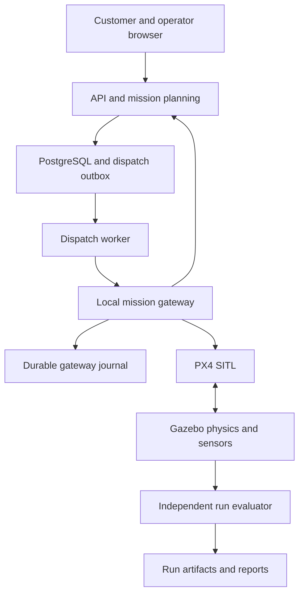

# Drone Delivery Simulation Software Design

Version 1.0 | 23 October 2026 | Project owner Makomane Tau

## 1 Purpose and implementation decision

Build a local physics based delivery simulation before considering aircraft hardware. The first complete product will accept a delivery request, validate a fixed route, require operator approval, fly a simulated package from pad A to pad B, land and disarm, confirm a simulated handover, and fly back to A. It will preserve the evidence needed to explain success, failure, and recovery.

This is the full software design for that product and its staged extensions. `CODEX_IMPLEMENTATION.md` translates it into implementation tasks. `AGENTS.md` supplies repository instructions. These files specify work to be built; they do not certify an existing implementation or a tested laptop setup.

The confirmed constraints are a Windows laptop with 16 GB RAM, a generic test environment first, and simulation before hardware. Payload, distance, route geometry, tolerances, and resource budgets below are proposed experiment settings. They are not aircraft capability claims. The original project handover supplies the longer term delivery vision; the later simulation first decision controls the current scope.

## 2 Scope and release boundaries

The simulation MVP includes one PX4 SITL quadrotor, a small Gazebo world, two pads, one physically modelled payload, a durable mission executive, an API and database, a browser operator console, a minimal customer request view, fault scenarios, and run reports. It is a supervised waypoint delivery experiment. The flight controller supplies flight stabilization.

Later software releases may add measured sensor noise, wind profiles, a real location, perception, replanning, and multiple simulated vehicles. The architecture leaves interfaces for these features but does not require them to demonstrate the MVP.

Payments, public customer accounts, live notifications, mobile apps, cloud deployment, real aircraft connections, hardware drivers, commercial dispatch, dynamic obstacle avoidance, and fleet optimization are outside this release. A route validator using known world geometry is not a perception system. A successful simulation does not establish physical flight performance or operational approval.

## 3 Users and responsibilities

| Role | Allowed actions | Main interface |
|---|---|---|
| Requester | Create and inspect own simulated deliveries | Customer view |
| Operator | Review, approve, dispatch, request recovery, confirm handover | Operator console |
| Maintainer | Configure experiment profiles, import models, run test suites | CLI and repository |
| Mission gateway | Execute one approved mission and report observations | Internal authenticated API |
| Experiment evaluator | Read simulation truth and calculate results | Run evaluator |

The local developer may use all roles, but the API must enforce the distinction. Requester endpoints never expose flight commands. QGroundControl is a secondary engineering tool; normal demonstrations run with its commanding controls unused. Any manual QGroundControl intervention is recorded and invalidates a nominal unattended test result.

## 4 Baseline experiment and world contract

| Setting | Proposed baseline | Interpretation |
|---|---|---|
| Vehicle | PX4 Gazebo X500 derived model | Simulation model only |
| Pads | A at ENU 0 0 0 and B at ENU 100 0 0 metres | Centres in one flat world |
| Pad radius | 5 m | Clear controlled landing area |
| Route | Vertical climb, horizontal transit, vertical landing | Two separately uploaded flight legs |
| Cruise | 20 m above flat world ground at 5 m/s | Same cruise in each direction |
| Package | 0.25 kg and 0.15 by 0.10 by 0.08 m | Configurable rigid box |
| Fence | East minus 30 to 130 m, north minus 60 to 60 m, ground to 40 m | Validate supported PX4 fence representation |
| Wind | Zero initially | Separate verified wind cases later |
| Building | Centre east 50 north 20 m, size 20 by 12 by 10 m | Solid collision geometry |
| Vegetation proxy | Centre east 75 north minus 18 m, height 8 m | Simple collidable geometry |
| Concurrency | One active run and one vehicle | Batch experiments run sequentially |

World configuration stores a named geodetic origin with latitude, longitude, and elevation above mean sea level. Milestone M0 must discover the selected PX4 world origin, explicitly align Gazebo spherical coordinates and the mission conversion to it, and freeze it in configuration. Do not assume that a displayed GPS home creates buildings or terrain.

Check route segments against obstacle shapes expanded by the aircraft envelope and a 3 m clearance margin. Check the entire swept path, including climb, descent, and the return leg. Ground contact is allowed only during planned pad operations. Keep any fallback route in the same geometry contract. Package dimensions must fit the mount without initial interpenetration.

## 5 Requirements and traceability

| ID | Requirement | Acceptance evidence |
|---|---|---|
| FR01 | Validate package, route, world, vehicle, and credentials before approval | T01 and T02 |
| FR02 | Require operator approval of a specific immutable plan revision | T03 |
| FR03 | Reserve one aircraft for one active mission atomically | T04 |
| FR04 | Execute outbound and return with observed landing and disarming | T05 |
| FR05 | Model package mass and confirm its physical removal | T06 |
| FR06 | Persist state, command intent, events, approvals, and outcomes | T07 |
| FR07 | Reconcile reconnects and restarts before further commands | T08 |
| FR08 | Expose live telemetry with freshness and source information | T09 |
| FR09 | Support explicit cancellation and phase dependent recovery | T10 |
| FR10 | Run versioned fault scenarios and produce comparable reports | T11 |
| FR11 | Separate simulator truth from flight decision inputs | T12 |
| FR12 | Reject physical vehicle endpoints in this release | T13 |
| FR13 | Reproduce a run from a manifest and stored assets | T14 |

Nonfunctional requirements are bounded memory use, recoverable process failures, explicit time semantics, an auditable command path, schema versioning, and reproducible builds. A browser failure must not terminate an active flight. An unavailable API must not destabilize the autopilot or erase the local mission record.

## 6 Architecture and process ownership

Use a monorepo with a modular FastAPI backend, a separate Python mission gateway, and a React TypeScript frontend. The gateway runs beside PX4 and Gazebo in Ubuntu through WSL2. Keep the simulator outside application containers for the initial setup. Use PostgreSQL locally, preferably as an Ubuntu service; containers are optional after the baseline is measured.

The API owns users, orders, route revisions, approval, and business projections. Its planning module creates flight plans; it does not stabilize the aircraft. The dispatch worker delivers durable intents from an outbox. The gateway owns execution state, vehicle ownership, command serialization, telemetry interpretation, and its SQLite journal. PX4 owns flight modes, stabilization, and configured failsafes. Gazebo owns physical state. The evaluator reads ground truth for metrics and test assertions.

Run one gateway process per simulated vehicle. Enforce a process lock around its journal and command channel; a second process must fail startup. Do not add a message broker, Kubernetes, ROS 2, or a separate fleet service to the MVP.

## 7 Technology and version policy

| Layer | Design choice | Pinning requirement |
|---|---|---|
| Host | Windows with WSL2 and WSLg | Record Windows, WSL, graphics, and distro versions |
| Linux | Ubuntu 24.04 candidate baseline | Validate with selected PX4 release |
| Autopilot | PX4 stable release in the 1.17 documentation family as first candidate | Pin exact release commit and submodules after M0 |
| Simulator | Gazebo Harmonic candidate baseline | Record exact package versions and physics engine |
| Integration | MAVSDK Python asyncio adapter | Select one API generation and pin wheel version |
| Python | 3.12 candidate runtime | Commit lockfile and runtime version |
| API | FastAPI, Pydantic, SQLAlchemy, Alembic | Resolve compatible versions and lock |
| Storage | PostgreSQL 16 candidate plus SQLite gateway journal | Pin DB major and migrations |
| Browser | React, TypeScript, Vite, simple SVG site view | Lock dependencies and Node runtime |
| Verification | pytest, Ruff, type checking, Vitest, Playwright | Pin tools with application dependencies |

The official PX4 setup documentation supports WSL2 and Ubuntu based development. Its Ubuntu instructions describe Harmonic installation. These establish a candidate setup, not evidence that the full project combination works [S1, S2].

Current MAVSDK documentation describes a newer Python asyncio interface and distinguishes it from the earlier gRPC interface. M0 should prefer the current supported asyncio interface if its required features pass the spike. If a pinned gRPC release is selected instead, record the reason and matching reference. Never combine imports, connection APIs, or generated types from different generations [S4].

Commit `toolchain.lock.yaml` after the first successful smoke flight. It records exact PX4 SHA and submodule SHAs, MAVSDK package and API generation, Gazebo and physics packages, OS, Python, Node, QGroundControl, model hashes, parameter dump, and docs URLs. Do not leave production setup tracking floating `main`, `latest`, or unbounded package versions.

## 8 Local runtime and resource design

Keep source and builds in the WSL Linux filesystem for the working copy. Run one world and one vehicle. Open Gazebo GUI during visual debugging, and use headless mode for repeated runs. The first scene uses primitive geometry without cameras, LiDAR, high resolution textures, or live video. QGroundControl may run in WSLg to keep the first networking configuration within Linux; Windows hosting is an optional documented alternative.

Suggested initial WSL budget is approximately 8 to 10 GB RAM with room left for Windows. This is a tuning starting point, not an instruction to change the host automatically or a guarantee of performance. Start build parallelism at two workers and measure memory pressure. Record CPU, GPU, SSD space, peak resident memory, swap activity, disk growth, and real time factor. A 16 GB label alone does not establish graphics compatibility.

| Connection | Default proposed endpoint | Boundary |
|---|---|---|
| Browser to frontend | localhost 5173 | Development only |
| Browser to API | localhost 8000 | Same origin proxy preferred |
| Worker to gateway | 127.0.0.1 8100 in WSL | Authenticated internal HTTP |
| API to PostgreSQL | 127.0.0.1 5432 | Local credentials |
| Gateway to PX4 | UDP receive port 14540 candidate | Verify from PX4 startup and SDK generation |
| QGroundControl | UDP port 14550 candidate | Separate engineering link |
| Gazebo transport | Local discovered topics and services | Record actual namespace and partition |

Use localhost binding where supported. If the SDK requires a wildcard receive socket, restrict traffic with the local network configuration and an allowlisted simulator peer. The release must reject serial, TCP, remote UDP, and discovered hardware devices unless a future hardware implementation deliberately adds them. Connection eligibility requires the configured endpoint, expected vehicle IDs, and a locally started simulator run token; no single identifier proves a vehicle is simulated.

## 9 Coordinate frames and time

Public project geometry uses local ENU metres: x east, y north, z up. MAVSDK or MAVLink adapters may require NED or global coordinates. Name fields explicitly with units and frames. Conversion between ENU position and NED is north equals ENU y, east equals ENU x, down equals negative ENU z. Body frame quantities must be tagged separately and must not reuse world frame types.

Use a geodesy library for local to geodetic conversion. Global mission items must declare their altitude datum. Prefer absolute mean sea level altitude for both legs if supported by the pinned PX4 and MissionRaw path; otherwise implement and test a documented conversion for each mission frame. Never pass 20 m AGL as 20 m above mean sea level. The flat baseline makes world ground equal to origin elevation, but that simplification must not leak into future terrain support.

Store `recorded_at_utc`, `source_boot_id`, `source_time_us` when available, `sim_time_ns`, and receiver monotonic timestamps. Use UTC for audit, simulator time for flight duration and scenario scheduling, and receiver monotonic time for process deadlines and stale telemetry. Source sequence numbers are ordered only within a boot and stream. A simulator reset creates a new run ID and time epoch.

A paused world is visibly PAUSED. Do not let a paused clock make a dead gateway appear healthy. The real time watchdog still detects unavailable processes. Exact numeric reproducibility is not promised across operating systems, physics versions, or threads; preserve tolerances and manifests.

## 10 Order and mission models

Keep business delivery status separate from aircraft execution state. An order moves through REQUESTED, VALIDATED, APPROVED, IN_PROGRESS, DELIVERED, and CLOSED, with REJECTED, CANCELLED, or DELIVERY_FAILED outcomes. DELIVERED requires payload handover evidence. CLOSED includes the eventual flight outcome; an order can be delivered even if the return fails.

Gateway execution states are PLANNED, PREFLIGHT, OUTBOUND, LANDED_AT_B, HANDOVER_PENDING, RETURN_READY, RETURNING, and COMPLETED. Exceptional states are RECOVERY_PENDING, RECOVERING, CANCELLED, and FAILED. Each mission also has `execution_confidence` of KNOWN, STALE, or UNKNOWN. Loss of observation changes confidence without inventing an aircraft state.

| Transition | Mandatory guard | Durable evidence |
|---|---|---|
| PLANNED to PREFLIGHT | Valid approved revision and aircraft reservation | Approval, plan hash, run identity |
| PREFLIGHT to OUTBOUND | Fresh health, fence, loaded payload, clear pads, uploaded outbound plan | Preflight checklist and start observation |
| OUTBOUND to LANDED_AT_B | Position in B envelope, landed detector, disarmed, stable dwell | Telemetry samples and leg outcome |
| LANDED_AT_B to HANDOVER_PENDING | Landing evidence complete | Handover request event |
| HANDOVER_PENDING to RETURN_READY | Authorized handover plus physical detach confirmation | Payload result and evidence IDs |
| RETURN_READY to RETURNING | Fresh return preflight and separate approval | Return plan, arm and start observations |
| RETURNING to COMPLETED | Landed and disarmed at A, terminal records saved | Return leg and run summary |

Landing guard defaults are horizontal estimated error at most 2 m, horizontal speed below 0.2 m/s, vertical speed magnitude below 0.2 m/s, landed detector true, disarmed true, and a two second simulator time dwell. Validate estimator and ground truth error independently. The guard is an experiment criterion and may require tuning without weakening acceptance silently.

Return departure requires a new operator action after handover. It checks aircraft health, destination A availability, home behavior, fence, plan revision, and energy model. Departure approval has a 60 second real time expiry. A stale approval cannot start a newly reconnected mission. Editing a route, payload, vehicle profile, world, or safety parameters invalidates prior approval.

## 11 Flight planning and autopilot integration

Use uploaded autopilot missions for waypoint execution. The Python gateway coordinates flight legs; it does not stream low level setpoints in the MVP. Use the SDK MissionRaw capability when explicit takeoff, route, and landing items are required. M0 must prove the selected SDK exposes all necessary mission functions. A simpler Mission plugin is acceptable only if the landing and restart semantics remain explicit and tested [S5].

Each outbound and return plan contains climb, transit, and landing actions supported by the pinned PX4. A start acknowledgement only proves command acceptance. Observe flight mode, armed state, mission progress, position, velocity, and landed status to determine actual completion. Do not issue a landing command immediately because the last transit item was accepted.

Read back or otherwise reconcile the uploaded mission and compare its normalized fingerprint before starting it. Serialize upload, start, arm, and recovery actions. Only one leg is uploaded at a time; the return leg is never automatically started after arrival at B. Repeated delivery requests must not rearm a landed vehicle.

Home handling is a mandatory spike. PX4 may establish or change home at arming, including rearming at B. Store observed home per leg, use the explicit route to return to A, and test the actual failsafe target for each phase. Do not assume return to launch will always mean pad A. If the required behavior cannot be configured and verified, stop that scenario rather than claiming successful recovery.

Separate the project's estimated geofence precheck from the onboard fence. Verify the selected PX4 fence supports the required horizontal polygon and altitude limits; translate coordinates and test breach response. Validation alone is not an onboard fence.

## 12 Payload physics and handover

Model the package as a separate rigid body with positive mass, collision geometry, an inertia tensor derived from its box dimensions, and a fixed attachment to the aircraft. Preserve the licensed baseline X500 model and record all changes. Mount position, aircraft centre of mass, inertia, landing gear clearance, and initial collision checks are recorded. The payload must add 0.25 kg to the combined assembly rather than appearing only as an API field.

Use Gazebo's DetachableJoint system as the first attachment candidate. Its supported behavior and physics limitations must be tested in the chosen build [S6]. If a minimal simulation plugin is needed, isolate it under the simulator adapter and document why a stock system was insufficient. A visual box alone does not pass M3.

Handover is a two part operation. The operator authorizes a simulated removal only after landing and disarming. The simulator adapter detaches the joint, confirms the physical relationship changed, and moves or removes the independent package after it is clear of the aircraft. The vehicle must stay at its current physical pose; it must not be respawned or reset to fake unloading.

Persist a handover request ID and query actual joint state after a timeout. Duplicate requests return the same outcome. If an API cannot expose joint state directly, implement an observable simulator event or minimal status plugin before accepting handover evidence. A jam fault keeps the package attached and blocks the standard empty return plan. The operator can choose a separately validated loaded recovery plan; the software must not silently treat the package as removed.

For the first experiment, package removal is supervised simulator interaction. It does not simulate a real person safely approaching rotors. Physical mechanism and human approach design remain later engineering work.

## 13 Sensor inputs and evaluation truth

The gateway uses PX4 estimated telemetry and declared operational inputs such as operator pad availability. It does not read Gazebo vehicle truth to steer the drone or claim obstacle detection. A future perception adapter will consume explicit simulated camera or range sensor messages and publish observations with confidence and timestamps.

The evaluator may read simulator poses, collisions, and attachment state to calculate landing error, clearance, mass validation, and collision counts. Payload attachment state is also available to the simulated mechanism interface as its own sensor equivalent. Label that exception in the manifest; it is not a navigation input.

GNSS tests must alter the sensor path or autopilot failure interface if they claim to test navigation degradation. Dropping a dashboard position update tests telemetry freshness only. A ground truth blocked pad flag is an explicitly simulated operator input in the MVP, not visual perception.

## 14 Commands and durable dispatch

Every mutating API request carries an `Idempotency-Key`. Store its actor, operation, canonical request hash, result, and expiry policy. The same key and same body returns the original result; the same key with a different body returns HTTP 409. Use a unique database constraint, not an in-memory cache. Keep mission command keys for at least the lifetime of the retained mission.

An API transaction stores the mission intent, reservation, state version, and outbox item together. A single local worker leases pending outbox rows and delivers to the gateway. Delivery is at least once. The gateway first writes the command ID and payload hash into its SQLite journal, then responds with receipt. A receipt does not mean the aircraft accepted or completed the action.

Command lifecycle is CREATED, RECEIVED, SENT, ACKNOWLEDGED, OBSERVED_SUCCEEDED, OBSERVED_FAILED, or OUTCOME_UNKNOWN. Commands include expected mission version, leg ID, plan hash, expiry, actor, and a monotonically increasing dispatch generation. Reject expired or obsolete generations. Backend and gateway use a stable event ID and per mission sequence for replay deduplication.

No software can guarantee exactly once physical actions through arbitrary failures without actuator support. If the gateway crashes after sending an action and before recording its outcome, reconnect and observe first. Do not automatically resend arm, start, detach, or recovery actions whose outcome is unknown. Require a recorded reconciliation decision.

## 15 Persistence model and consistency

| Record | Important fields and constraints |
|---|---|
| users | UUID, role, password hash or identity subject, enabled flag |
| orders | Requester, payload mass and dimensions, delivery status, mission ID |
| vehicles | Sim vehicle ID, capability profile revision, reservation, active flag |
| worlds and routes | Immutable revision, origin, pads, geometry and asset hashes |
| missions | Order, vehicle, run ID, world and route revisions, state projection, version |
| mission_legs | OUTBOUND or RETURN, uploaded plan hash, observed home, outcome |
| approvals | Actor, action, plan hash, expiry, consumed timestamp |
| commands | Unique command ID, idempotency key, request hash, lifecycle, result |
| mission_events | Unique event ID, mission sequence, previous and next state, timestamps |
| dispatch_outbox | Intent, attempts, next retry, lease, delivered receipt |
| handover_evidence | Operator, joint result, run time, payload ID, artifact references |
| simulation_runs | Manifest hash, mode, seed, outcome, elapsed times, artifact index |
| telemetry_samples | Downsampled estimated values, stream ID, source boot, timestamps |
| artifacts | Relative path, SHA256, media type, size, producer, run ID |

Use UUID identifiers and UTC timestamp columns. Validate all masses, dimensions, coordinates, speeds, and limits as finite values with units. Order to mission uniqueness enforces one simulation mission per order in the MVP. Retrying a failed experiment creates a new order linked by `retries_order_id`; it preserves the old evidence. Enforce a partial unique index for an active vehicle reservation.

Release a reservation only after a reconciled terminal outcome with the vehicle confirmed landed and disarmed, or after recorded test harness termination makes that simulator instance unavailable. A lost connection, expired worker lease, or UNKNOWN confidence must not free the vehicle for another mission. After a reset, a new simulator instance receives a new run identity before it can be reserved.

The gateway SQLite journal stores missions, command intents and outcomes, events, received dispatch generations, current execution checkpoint, and outbound event delivery markers. Use WAL mode and durable transactions; test abrupt termination. It is authoritative for live execution. PostgreSQL is authoritative for order ownership, plan revisions, and approval records. API mission state is a projection with an explicit last synchronized sequence and gateway freshness.

A gateway restart enters reconciliation. Read journal, identify the same simulator run and vehicle boot, reconnect, observe actual flight state and mission, and compare with the checkpoint. Rehydrate monitoring automatically when identities agree, but inhibit further actuation until unknown commands are resolved. An operator may then approve a documented continuation. If identities differ, preserve the old mission and require a new run.

## 16 Public API and errors

Version the API under `/api/v1`. Publish generated OpenAPI and generate frontend types. The API receives route IDs and package facts; clients cannot upload arbitrary MAVLink instructions or filesystem paths.

| Method and path | Role | Result |
|---|---|---|
| POST /auth/login and POST /auth/logout | Any local user | Session lifecycle |
| GET /me | Signed in | Identity and roles |
| GET /routes | Signed in | Published simulation route revisions |
| POST /orders | Requester | Validated order and planned mission |
| GET /orders/{id} | Owner or operator | Delivery view |
| GET /missions and GET /missions/{id} | Operator | Planning and execution projection |
| POST /missions/{id}/validate | Operator | Validation findings and plan hash |
| POST /missions/{id}/approve | Operator | Expiring approval for an action |
| POST /missions/{id}/dispatch | Operator | 202 command receipt reference |
| POST /missions/{id}/handover | Operator | 202 simulated removal request |
| POST /missions/{id}/return | Operator | 202 return departure request |
| POST /missions/{id}/cancel | Operator or owner before dispatch | Cancellation or conflict |
| POST /missions/{id}/recover | Operator | Requested supported recovery action |
| GET /commands/{id} | Authorized mission reader | Receipt, observation, outcome |
| GET /runs/{id} and GET /runs/{id}/report | Operator or maintainer | Manifest, results, artifacts |
| GET /health/live and GET /health/ready | Local monitoring | Process health and dependencies |

Validation does not approve dispatch. Request body for an order contains `route_revision_id`, `payload.mass_kg`, `payload.dimensions_m`, and an optional nonpersonal test reference. Dispatch contains `approval_id`, `expected_mission_version`, and `plan_hash`. Handover contains `expected_mission_version` and `evidence_note`. Return and recovery require their own matching approvals. Use `If-Match` or explicit expected version consistently; return 409 on stale versions.

Errors have `code`, `message`, `request_id`, optional `mission_id`, and structured field details. Use 401 for missing identity, 403 for forbidden actions, 404 without leaking another requester's order, 409 for state conflicts, 422 for invalid values, and 503 for unavailable gateway or dependencies. Examples include PAYLOAD_LIMIT, APPROVAL_EXPIRED, TELEMETRY_STALE, PLAN_CHANGED, VEHICLE_BUSY, and COMMAND_OUTCOME_UNKNOWN. Never return a success state because a transport call timed out.

## 17 Gateway internal contract

Expose only to the local worker and API with a generated shared secret supplied outside source control. Require a run token and vehicle ID on every execution intent. Proposed endpoints are POST `/internal/v1/intents`, GET `/internal/v1/intents/{id}`, GET `/internal/v1/snapshot`, and GET `/internal/v1/events?after_sequence=N`.

An intent envelope has `schema_version`, `intent_id`, `mission_id`, `mission_version`, `dispatch_generation`, `run_id`, `vehicle_id`, `leg_id`, `operation`, `plan_hash`, `expires_at_utc`, `approval_reference`, and a validated operation payload. Operations are START_OUTBOUND, CONFIRM_HANDOVER, START_RETURN, and REQUEST_RECOVERY. The gateway verifies immutable plan data, limits, approval scope, and current observations even after the API has checked them.

Gateway events include `event_id`, `mission_sequence`, `run_id`, `vehicle_boot_id`, `type`, timestamps, and data. Replay uses mission sequence; an event gap triggers full snapshot reconciliation. The API acknowledges the highest durably stored sequence. Never discard unacknowledged terminal events. Keep structured receipts separate from streamed telemetry.

## 18 Streaming and operator interface

The MVP frontend has six views: request delivery, mission queue, mission detail and site view, telemetry and alerts, experiment results, and configuration summary. Use an SVG top down map with ENU axes, pads, fence, obstacles, planned route, and estimated track. Gazebo remains the 3D view. This avoids a second browser 3D engine and external map dependencies.

Mission detail shows order status, execution state, confidence, armed state, flight mode, position, height datum, speed, battery model status, payload status, link age, approval expiry, command receipt and observed outcome, and a chronological event timeline. Distinguish SIMULATION, MOCK, and RECORDED REPLAY modes on every operational screen. A mock display cannot masquerade as SITL evidence.

Use WebSocket `/api/v1/stream` with authenticated mission subscriptions. Durable events include cursors. On reconnect, fetch snapshot and events after the last saved cursor; if retention removed them, replace with a complete snapshot. High rate telemetry is not replayed through the event stream. A bounded per client queue may replace old telemetry with the latest sample; it must not silently drop terminal events. Disconnect slow clients with a resynchronization reason.

Target estimated position display at 5 Hz and database downsampling at 1 Hz. Mark stale after 2 s and unavailable after 5 s of receiver monotonic age, configurable and tested under normal speed. Show source time and gateway age separately. Controls explain why an action is disabled. A recovery button opens the permitted choices for the current phase and requests an observable action; it is not an unconditional motor kill switch.

## 19 Failure and recovery policy

| Fault | Baseline response | Evidence required |
|---|---|---|
| Browser closes | Gateway continues approved leg | Reopened view reconciles |
| API or database unavailable | No new departures or handovers; active gateway monitors current leg | Journal and later event replay |
| Gateway stops in outbound flight | PX4 completes its uploaded leg or applies configured link loss behavior | Actual PX4 mode and destination |
| Gateway reconnects | Monitor and reconcile; unknown commands inhibit actuation | Same run and mission fingerprints |
| Stale telemetry | Block new actions, mark confidence stale or unknown | Age and missing stream log |
| Command acknowledgement lost | Observe actual state before any retry | Command becomes resolved or unknown |
| Low estimated energy before departure | Block dispatch under model policy | Validation finding |
| Energy threshold crossed in flight | Invoke tested phase policy or allow PX4 battery failsafe | Injected fault and observed mode |
| GNSS degradation | Test configured navigation dependent failsafe | Sensor path injection proof |
| Pad B declared blocked before launch | Block dispatch | Scenario input and validation |
| Pad B blocked during outbound | Request tested diversion to A if navigation and energy permit | Recovery plan and outcome |
| Payload detach jams | Keep handover pending or mark delivery failed; block empty return | Joint remains attached |
| PX4 boot or simulator run changes | Preserve old outcome as interrupted; block continuation | Identity mismatch record |
| Collision or fence breach | Mark run failed and preserve evidence | Truth collision or boundary log |

Define recovery actions HOLD, RETURN_TO_A, LAND_AT_APPROVED_PAD, and STOP_RUN with explicit preconditions. HOLD needs valid position control; returning needs navigation, energy, and a clear route. STOP_RUN is test harness termination and must not be presented as an aircraft recovery. Landed cancellation is allowed only when disarming is observed. In flight cancellation becomes a recovery request and reaches a terminal state after the aircraft outcome is observed.

Set and export the actual PX4 link loss, battery, and fence parameters. Do not invent parameter names; read the pinned release. Test with QGroundControl connected and disconnected, because another heartbeat can mask the intended link loss fault. Distinguish loss of API, gateway MAVLink, telemetry display, and pilot control. PX4 failure injection support is conditional on build and simulator; each advertised scenario must prove its injection took effect [S7].

## 20 Energy and environmental realism

The first unloaded smoke test may use PX4's basic battery simulation for status, but label it UNCALIBRATED and do not infer range or payload efficiency from it. Before a delivery run passes the complete acceptance gate, introduce a documented load dependent energy estimate or a verified simulator battery integration. It must account for mission duration, payload state, and selected wind profile with all coefficients recorded.

Keep estimated energy separate from simulated PX4 battery percentage. Define a policy reserve of 30 percent of configured model capacity as an experiment assumption, and run sensitivity cases at other reserves. If battery load integration is unavailable, battery failsafe scenarios may use an explicitly injected battery fault; label that mechanism rather than claiming electrical realism.

Introduce wind only after the calm baseline. Verify a disturbance actually reaches the vehicle dynamics or sensor model; a world wind number with no force effect does not count. Start with zero and 2 m/s uniform cases, then add recorded gust profiles. Rain, urban turbulence, air density variation, propeller wash, and communications propagation remain unmodelled until a separate validated model is added.

## 21 Test strategy and scenario contracts

Use deterministic fake adapters for domain and failure logic tests; use real PX4 SITL for integration evidence. Mock results must be tagged and cannot satisfy flight gates. Each scenario YAML declares schema version, seed, world and vehicle revisions, payload, initial state, scheduled fault, injection mechanism, expected events, outcome criteria, and timeout. Reject unsupported scenario keys instead of ignoring them.

| Test | Scenario | Required result |
|---|---|---|
| T01 | Nominal request | One validated mission and no flight before approval |
| T02 | Invalid or nonfinite mass, oversize package, unsafe route | 422 or validation failure, no actuation |
| T03 | Requester dispatch or expired and changed approval | 403 or 409, no actuation |
| T04 | Concurrent dispatch and duplicate keys | One reservation and one logical execution |
| T05 | Calm A to B to A | Landed and disarmed at each pad, correct evidence |
| T06 | Loaded outbound and unloaded return | Physical mass and attachment checks pass |
| T07 | API stopped during outbound | Gateway survives and events replay without duplicates |
| T08 | Gateway terminated before and after command send | Reconciliation prevents blind action replay |
| T09 | Telemetry paused and resumed | UI stale thresholds and resync verified |
| T10 | Cancel on ground and recover in flight | Correct phase guard and observed aircraft result |
| T11 | Link loss, battery fault, blocked pad, payload jam | Injection verified and expected policy observed |
| T12 | Ground truth navigation access prohibited | Adapter boundary and tests prove isolation |
| T13 | Nonlocal endpoint or missing run token | Startup rejected before SDK connection |
| T14 | Clean setup and same scenario rerun | Manifest complete and outcomes within tolerances |
| T15 | Coordinate frame and altitude conversions | ENU NED round trips, pad mapping, datum checks |
| T16 | Rearm at B and return home behavior | Return reaches A and actual recovery target logged |
| T17 | Stream gaps and slow browser client | Durable events recovered and queues bounded |

Every injection records requested time, actual effective time, mechanism, support check, and observed effect. A skipped unsupported fault is SKIPPED with a reason, never PASSED. GNSS degradation and loss of the MAVLink connection are separate scenarios. Run a process crash at the intent commit, send, acknowledgement, and observed completion boundaries with fake adapters before repeating selected boundaries in SITL.

## 22 Metrics and acceptance gates

| Metric | Proposed acceptance | Source |
|---|---|---|
| Nominal completion | 10 of 10 sequential calm runs complete both legs | Events and aircraft observations |
| Landing horizontal error | At most 2 m at A and B in each nominal run | Evaluator truth plus estimated guard |
| Obstacle clearance | At least 3 m from expanded vehicle envelope outside allowed pad contact | World geometry and truth trajectory |
| Collisions and fence breaches | Zero in nominal runs | Simulator contact and fence evidence |
| Duplicate dispatch | Zero duplicate logical starts or handovers in concurrency suite | DB and gateway journal |
| Recovery evidence | Every supported baseline fault matches its declared outcome | Fault reports |
| Nominal run duration | At most 180 simulated seconds excluding operator waits | Simulator clock |
| Active baseline real time factor | Median at least 0.8 over a 60 s observation window | Simulator and host clocks |
| App response | Local mission reads below 500 ms at p95 in a bounded test | API timing |
| Local resource headroom | No out of memory events; documented Windows and WSL use | Host measurements |

These thresholds are design targets, not observed results. Record failures rather than relax tolerances after a run. Ten successes are a software regression gate, not a statistical reliability or aviation safety claim. Store both absolute landing error and estimation error. Define clearance over a sampled path with conservative swept segment interpolation; report sampling interval and geometry assumptions.

Reports include trajectory, landing results, durations by phase, command latency, tracking error, min clearance, collision count, recovery steps, estimated energy, software versions, and artifact completeness. Metrics that depend on an unimplemented model must be UNAVAILABLE, not zero.

## 23 Observability and run artifacts

Each run writes a local directory `runs/<run_id>/` containing manifest JSON, scenario YAML, event JSONL, estimated telemetry Parquet, ground truth Parquet, PX4 ULog, parameter export, command journal export, evaluator JSON, and human readable report HTML. Capture simulator logs and optional short video only on demand. Include relative paths, SHA256 hashes, sizes, producer version, and creation time in the artifact index.

Logs use structured JSON with run, mission, leg, command, request, and event IDs. Redact credentials and avoid recording actual recipient data. Record the process clock source and telemetry stream rates. Runtime artifacts are ignored by git; keep small artificial fixtures separately.

Retain the latest 20 ordinary local runs by default, bounded by a configurable disk budget. Pin failed or explicitly preserved runs. Export before deletion, record artifact status, and never silently delete a run being evaluated. DB backup plus artifact directory backup is required to reproduce results; neither alone is sufficient.

## 24 Security and configuration

Default to local single developer operation. Seed requester and operator accounts using a setup command with generated credentials, never committed passwords. Hash passwords with a maintained password hashing library. Use an HttpOnly session cookie, same origin frontend proxy, CSRF protection for mutations, origin checking for WebSockets, role and object level authorization, and limited login attempts. No public exposure is required.

Use a separate internal gateway secret. Load secrets from ignored local environment files or host secret configuration; provide names only in `.env.example`. Redact logs. Route IDs, asset IDs, and scenario IDs resolve inside known directories. Do not accept arbitrary shell text, URLs, PX4 parameters, or file paths from customer requests. Recovery operations use a fixed allowlist.

Store configuration in versioned typed YAML with strict unknown field rejection. Separate world, aircraft, operating policy, scenario, and environment configuration. Compute the approved plan hash over the resolved configuration, not just a route name. Preserve dependency licenses and external asset attribution. Future real address or camera processing needs a separate privacy design before collection.

## 25 Repository structure and code boundaries

| Location | Responsibility |
|---|---|
| apps/api | FastAPI routers, identity, database models, migrations, outbox worker |
| apps/gateway | Durable executive, telemetry processing, execution policy |
| apps/web | Requester view, operator console, generated API types |
| packages/domain | Python pure state machine, units, validation, shared models |
| packages/adapters | Fake flight adapter, MAVSDK adapter, simulator mechanism adapter |
| sim/worlds and sim/models | SDF worlds, derived aircraft, payload, license records |
| sim/plugins | Minimal C++ simulator extensions only when required |
| config | World, vehicle, policy, and local environment examples |
| scenarios | Versioned calm and fault experiment definitions |
| scripts | Doctor, setup, start, stop, evaluate, export, and cleanup commands |
| tests/unit and tests/integration | Domain, persistence, API, and gateway checks |
| tests/sitl and tests/e2e | Real flight and browser tests |
| docs | Design, decisions, setup, API contracts, and verification records |
| runs | Ignored local artifacts |

Pure domain code must not import FastAPI, MAVSDK, database drivers, or Gazebo. Adapters translate external types into domain types. The API never imports flight SDK command objects. Simulator truth readers live in the evaluator and payload adapter, not the flight executive. Dependency tests enforce these directions.

## 26 Development commands and delivery workflow

Implement a project CLI or Make targets for `doctor`, `setup`, `sim`, `gateway`, `api`, `web`, `test`, `test-sitl`, `evaluate`, `export-run`, and `stop`. These names are required interfaces to be built, not commands currently available in this document package. `doctor` is read only and reports versions, ports, available RAM, graphics support, and missing dependencies. Setup prompts only for host changes that actually need privileges.

The documented upstream smoke launch is `make px4_sitl gz_x500`; upstream also documents `HEADLESS=1 make px4_sitl gz_x500` [S3]. Project wrappers must verify the pinned checkout and asset paths before starting. Do not use broad process termination commands. Store process IDs and stop only processes owned by the current run. If still armed or outcome is unknown, label teardown as experiment interruption and preserve logs before terminating.

CI runs formatting, typing, pure domain, migration, API authorization, gateway fake adapter, and browser tests on every change. Run SITL on an environment that actually supports the pinned simulator. A CI lane without Gazebo can report SITL as NOT RUN with a reason; it must not convert mocks into a passing integration gate. Preserve failed run artifacts within available storage limits.

## 27 Implementation milestones

| Milestone | Deliverables | Exit evidence |
|---|---|---|
| M0 Environment and integration spike | Host inventory, pinned toolchain, stock X500 smoke flight, coordinate and mission API proof | Real takeoff land, explicit mission land, rearm, recorded home |
| M1 Domain and planning | Types, route geometry, state transitions, approval hashes, fake adapter | Invalid inputs and invariant tests |
| M2 Durable gateway | Journal, command lifecycle, uploaded outbound and return legs, reconciliation | Real two leg mission without payload plus crash checks |
| M3 Physical delivery model | Generic world, attached rigid body, detach verification, ground truth evaluator | Loaded outbound and unloaded return evidence |
| M4 Delivery API and storage | DB migrations, identity, reservations, approvals, outbox, event replay | Concurrent dispatch, authorization, restart tests |
| M5 Operator and requester interfaces | Site view, controls, stream freshness, report access | Browser flow and visible failure states |
| M6 Fault experiments | Verified wind, link, GNSS where supported, battery, pad and jam scenarios | Per scenario injection and outcome reports |
| M7 Repeatable release | Setup guide, run exports, acceptance report, documented limitations | Full nominal and supported fault gates |

M0 may reveal an incompatibility. Resolve or document it before committing to later integration code. M1 work with fake adapters may continue if the simulator is temporarily unavailable, but M2 and later flight gates remain pending. Each milestone is a reviewable implementation slice; no completion date is implied.

## 28 Risk register and software evolution

| Risk | Effect | Treatment |
|---|---|---|
| GPU or WSL limits | Slow or failed rendering | Measure early, use headless primitive world |
| API generation mismatch | Mission commands do not run | M0 feature spike and exact lock |
| Home or altitude confusion | Wrong return or landing target | Frame types, explicit A plan, rearm tests |
| Unsupported fault injection | False recovery confidence | Capability check and observed effect |
| Journal and API disagree | Duplicate or stale actions | One execution owner and replay sequences |
| Cosmetic payload or battery | Misleading realism | Physical mass proof and labelled energy model |
| Truth leaks into autonomy | Unrealistic navigation results | Adapter boundaries and evaluator separation |
| Excessive scope | No complete demonstration | One vehicle and fixed route until M7 |

After M7, choose one extension at a time. For a real location, import licensed terrain and building data and validate coordinate alignment. For perception, add the smallest sensor, explicit observation models, detection metrics, and bounded local planning. Introduce ROS 2 only when its communication and robotics packages solve a concrete integration need. For fleet support, extend reservations, namespaces, vehicle identities, scheduling, and conflict policies before running multiple vehicles. Physical integration requires a separate hardware adapter, configuration, review, and operating pathway; it must not be enabled by switching an environment variable in this release.

## 29 Open decisions and change control

The following decisions are assigned to M0: CPU and graphics suitability, WSL resource setting, exact PX4 release SHA, SDK API generation and package, supported mission frames, rearm and home behavior, stock detach observability, and supported fence and fault mechanisms. Energy coefficients are assigned to M3 and M6. Real location, physical payload, commercial use case, and hardware budget are deferred beyond this release.

Changes to state names, approved plan fields, public schemas, dependency generations, geometry units, or acceptance thresholds require an architecture decision record, updated tests, and updated design. An ADR states the problem, options, decision, evidence, consequences, and affected requirement IDs. Ordinary implementation choices within these boundaries can proceed without reopening product scope.

## 30 References and design provenance

The project inputs are the existing autonomous drone delivery handover and the confirmed conversation choices of simulation first, a generic environment, Windows, and 16 GB RAM. Numeric targets and architecture in this document are proposed engineering decisions. Official documentation below was checked on 23 October 2026. Moving main documentation is context; the implementation must store release matching references with its lockfile.

- S1 PX4 Windows development through WSL2 https://docs.px4.io/main/en/dev_setup/dev_env_windows_wsl
- S2 PX4 Ubuntu development environment https://docs.px4.io/v1.17/en/dev_setup/dev_env_linux_ubuntu
- S3 PX4 Gazebo simulation and launch modes https://docs.px4.io/main/en/sim_gazebo_gz/
- S4 MAVSDK Python QuickStart and API generation distinction https://mavsdk.mavlink.io/main/en/python/quickstart.html
- S5 MAVSDK mission capabilities and MissionRaw https://mavsdk.mavlink.io/main/en/cpp/guide/missions.html
- S6 Gazebo Harmonic detachable joints https://gazebosim.org/api/sim/8/detachablejoints.html
- S7 PX4 system failure injection https://docs.px4.io/main/en/debug/failure_injection
- S8 Gazebo Harmonic Ubuntu packages https://gazebosim.org/docs/harmonic/install_ubuntu/

